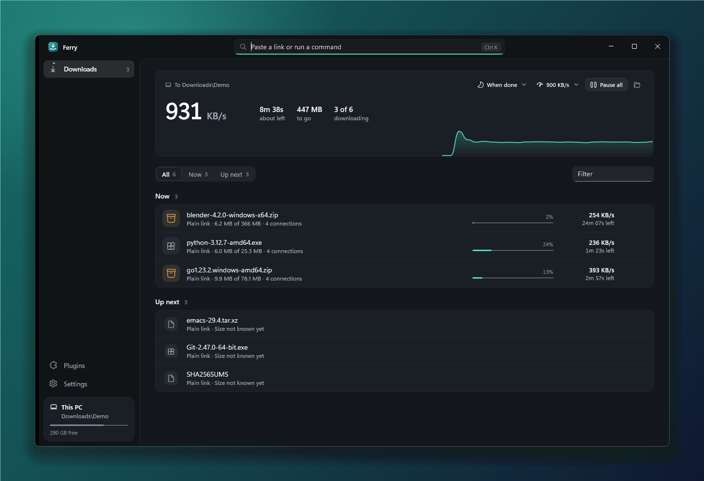
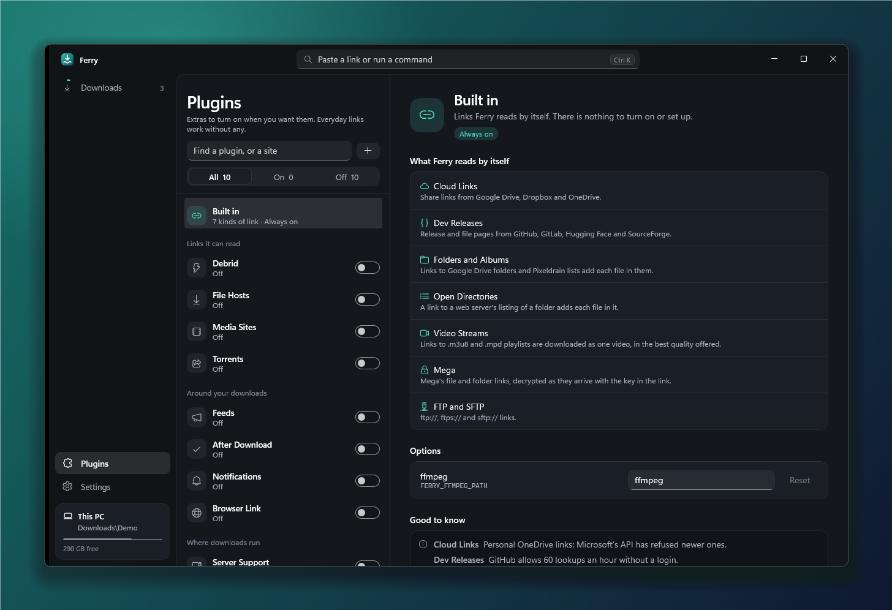
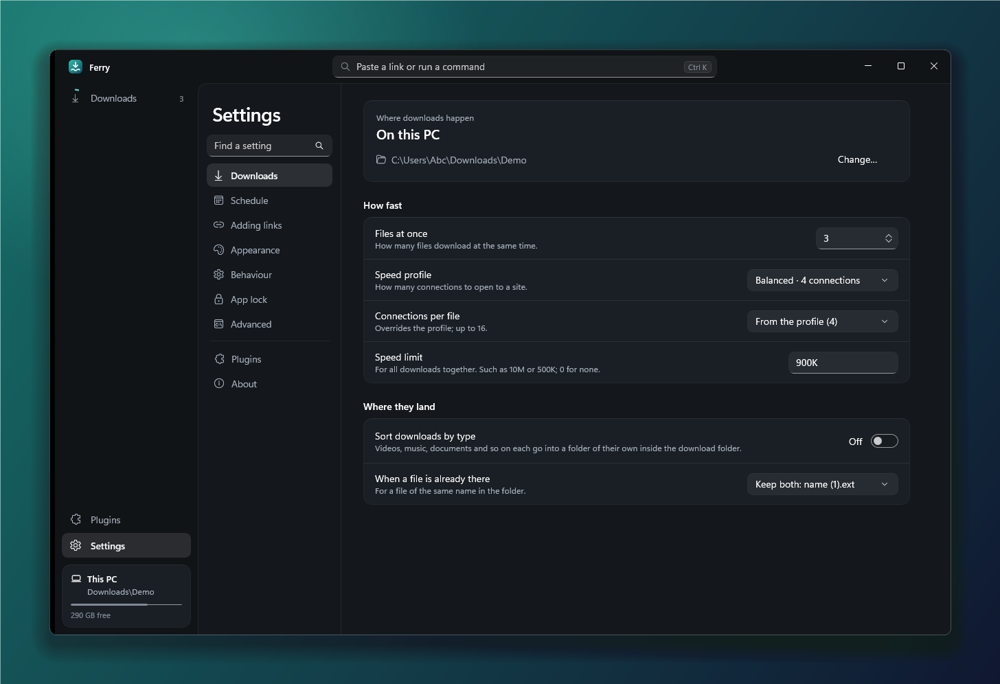

<div align="center">


# Ferry

**A download manager for Windows that can also download on a server of your own.**

Paste a link and it downloads over several connections, pausing and resuming where it stopped.

[](https://github.com/iStorry/ferry/actions/workflows/ci.yml)
[](LICENSE)


[Install](#install) · [Use](#use) · [Plugins](#plugins) · [Write a plugin](docs/writing-plugins.md) · [Build](#build)



</div>

## What it does

- **Fast, and it picks up where it stopped.** Each file comes over several connections. A connection that runs out of
  work takes half of what another still has, so all of them stay busy to the end. Pause, close the app, lose the
  connection: it carries on from the bytes it has.
- **Reads more than plain links.** Cloud share links, GitHub releases, folders, open directories, video playlists, Mega,
  FTP and SFTP work as they are. More is a switch away: torrents, feeds, debrid, video pages through yt-dlp.
- **Downloads on your own server.** Server Support puts a small agent on a Linux server over SSH. The server downloads,
  also while this PC is off, and Ferry brings the finished files over, checked with SHA-256.
- **Plugins people install.** A plugin teaches Ferry a site. It is a package you add from a file or a link, and it runs
  on your server, not on this PC.
- **Yours to shape.** A speed limit, a schedule, sorting by type, rules for finished files, a PIN on the window. Every
  setting is also an environment variable.
- **Quiet.** No account, no ads, no telemetry.

<table>
<tr>
<td width="50%"></td>
<td width="50%"></td>
</tr>
</table>

Ferry is at 0.0.1. Most plugins have been tried against fake servers only, not yet the real sites.

## Install

From [Releases](https://github.com/iStorry/ferry/releases). 0.0.1 is a pre-release, so it is listed there but not marked
as the latest:

- `Ferry-{version}-setup.exe` installs for your user (no admin). The installed app updates itself.
- `Ferry-{version}-win-x64-portable.zip` is the same app to run from a folder.

`SHA256SUMS.txt` on each release lists the files' checksums; the updater checks a downloaded setup against it before
running it. The builds aren't code-signed yet: Windows SmartScreen asks before the setup runs the first time (More info,
then Run anyway).

## Use

Paste links in the box at the top (Ctrl+K), or drop them on the window. An Add dialog shows each link's name and size
first. Settings holds the download folder, connections, speed limit, sort by type, the schedule and the rest. Plugins
turns each plugin on or off and holds its settings; what is built in is there as one entry, with nothing to turn on.

Every setting is an environment variable too (`FERRY_FILES_AT_ONCE=4`), which wins over the settings file. The file is
`%LOCALAPPDATA%\Ferry\settings.json`, or wherever `FERRY_CONFIG_PATH` points.

**App lock:** Settings, App lock asks for a 4-digit PIN each time the app opens. After a chosen number of wrong PINs in
a row the app opens empty instead, as a new install would. It is a lock on the window, not encryption: the queue stays
readable on disk. Forgot the PIN? Remove `%LOCALAPPDATA%\Ferry\secrets\app-lock.secret`.

## Plugins

**Built in.** These only make ordinary links work, so they are always on and have no switch. The Plugins page shows
them as one entry, Built in. Each still has its setting (`FERRY_PLUGIN_MEGA=false`) to turn it off from the settings
file or the environment.

| Built in | What it reads |
|---|---|
| Cloud Links | Share links from Google Drive, Dropbox, OneDrive and SharePoint |
| Dev Releases | Release and file pages on GitHub, GitLab, Hugging Face and SourceForge |
| Folders and Albums | Google Drive folders and Pixeldrain lists, each file in them |
| Open Directories | A web server's folder listing (Apache, nginx), each file in it |
| Video Streams | HLS (`.m3u8`) and DASH (`.mpd`) playlists, as one video in the best quality |
| Mega | Mega file and folder links, decrypted as they arrive |
| FTP and SFTP | `ftp://`, `ftps://` and `sftp://` links |

**Plugins.** These talk to a service, run a program you install, or send something, so they are off until you turn
them on.

| Plugin | What it reads or does |
|---|---|
| Server Support | Downloads on your own Linux server, brought over by SSH |
| File Hosts | Pixeldrain, MediaFire and Cyberdrop files; Gofile folders and Cyberdrop albums |
| Debrid | Links on the hosts you list, through Real-Debrid or AllDebrid |
| Media Sites | Video pages on the sites you list, through yt-dlp, which you install |
| Feeds | RSS and Atom feeds: new files are added by themselves |
| After Download | Scan finished files, unpack archives, move and rename by rules |
| Notifications | A Telegram, Discord or webhook message when a batch finishes |
| Remote Queues | An aria2 daemon or Synology Download Station does the downloading |
| Browser Link | "Download with Ferry" on a link in Chrome and Edge (`extensions/browser`) |
| Torrents | Magnet links and `.torrent` files; sharing stops when the download is done |

**More plugins** can be installed from a file or a link (Plugins, the + beside the search box). An installed plugin
runs on your server, not on this PC, so it needs Server Support. It is a program that can do whatever your user on the
server can, so install only what you trust. `docs/writing-plugins.md` says how to write one.

**Server mode** (Server Support) uploads a small agent, the same downloader, to a Linux server you own over SSH. The
server downloads, also while this PC is off, and Ferry brings the finished files here, checked with SHA-256.

## What Ferry sends by itself

- Once a day it asks GitHub whether there is a newer release of Ferry.
- For each plugin you installed from a GitHub release, it asks that repository whether there is a newer package: after it
  starts and when you open Plugins, at most once an hour. A repository that isn't public is asked with the access token
  you gave for it, which is kept encrypted for your Windows user and sent to GitHub only.

Settings, Check for updates turns both off. Nothing is installed without asking. There is no telemetry.

## Build

Needs the .NET 10 SDK pinned in `global.json`. The app builds on Windows only.

```powershell
dotnet build Ferry.slnx
dotnet test Ferry.slnx
dotnet run --project src/Ferry.App
```

Set `FERRY_CONFIG_PATH` to a file in a scratch folder first, so a build's settings don't mix with an installed
Ferry's. `docs/shipping.md` has the publish scripts and the release steps.

## Layout

| Path | What it is |
|---|---|
| `src/Ferry.Core` | The downloader: sites (`ISite`) and plain links, the segmented engine, retries, file names, settings, the queue, updates. |
| `src/Ferry.App` | Ferry for Windows: WinUI 3, unpackaged and self-contained. |
| `src/Ferry.Agent` | The helper the app runs: on a server it is the agent; on Windows it answers ssh's password prompt and the browser extension. |
| `src/Ferry.Plugins.*` | One project per plugin, no UI; `Ferry.Plugins.Official` lists them. |
| `src/Ferry.Plugins.Host` | Loads an installed plugin's code, where code can be loaded: the server's agent and the pack tool. |
| `samples`, `tools/Ferry.PluginPack` | A plugin to copy from, and the tool that packs one (`docs/writing-plugins.md`). |
| `extensions/browser` | The Browser Link extension for Chrome and Edge. |
| `installer`, `tools` | The Inno Setup script and the publish scripts. |
| `tests/Ferry.Core.Tests` | xUnit tests, against local fake servers; none contacts a real site. |
